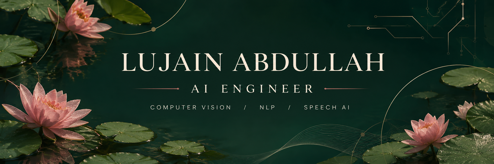

 

 

---

## 🌿 About Me

I'm **Lujain Abdullah Al Mubarak**, an **Information Systems graduate from King Khalid University**, where I graduated with **Second Class Honors**.

I'm passionate about building practical AI systems that connect machine learning research with real-world applications.

My interests span **Computer Vision, Arabic Natural Language Processing, Speech AI, and Large Language Models**. I enjoy working across the AI lifecycle — from exploring datasets and training models to evaluating results and building intuitive applications.

- 🎓 **Education:** B.Sc. in Information Systems — King Khalid University
- 🧠 **Specialization:** Artificial Intelligence & Machine Learning
- 🔬 **Technical Interests:** Computer Vision · Arabic NLP · Speech Recognition · LLMs
- 🌱 **Currently Exploring:** Underwater Object Detection · Model Fine-Tuning · AI-Powered Content Intelligence
- 📍 **Location:** Saudi Arabia

### Experience & Learning

- **Digital Transformation & IT Intern — Aseer Municipality:** Developed a training management system supporting trainee, supervisor, and administrative workflows.
- **AI Engineering Training:** Applied computer vision, NLP, speech processing, and model evaluation through hands-on projects.
- **Samsung Innovation Campus:** Collaborating with Team Tech Orbit (Group 12) on the MarineGuard AI capstone project.

---

## 🫒 Technical Toolkit

**Programming & Data**

  

**AI & Application Development**

  

**Development Tools**

  

---

## 🌸 Featured AI Projects

<table>
<tr>
<td width="50%" valign="top">

### 🔥 HOSN — Wildfire Detection

A computer vision system designed to detect **fire and smoke** in visual feeds, supporting early wildfire awareness and monitoring.

**Focus:** Object Detection · Deep Learning · Real-Time Monitoring

</td>
<td width="50%" valign="top">

### 🎙️ NABRA — Arabic Call Intelligence

An Arabic call intelligence pipeline combining **Whisper ASR**, speaker diarization, and **Qwen** to transform conversations into structured insights.

**Focus:** Whisper · PyAnnote · Qwen · ASR Evaluation

</td>
</tr>

<tr>
<td width="50%" valign="top">

### 📄 FAHS — Intelligent Document Analysis

An AI-assisted application for analyzing Arabic compliance-related documents and supporting structured document review.

**Stack:** Gemini · React · TypeScript · Supabase

</td>
<td width="50%" valign="top">

### 🌊 MarineGuard AI — Underwater Detection

A Samsung Innovation Campus team project exploring YOLO-based detection of fishing nets and ropes in underwater imagery.

**Focus:** YOLO · Transfer Learning · Underwater Object Detection

**Team:** Tech Orbit — Group 12

</td>
</tr>

<tr>
<td colspan="2" valign="top">

### ✨ SADA — AI-Powered Media Intelligence

An evolving AI project exploring intelligent approaches to digital content, communication, and media-related workflows.

**Focus:** NLP · Applied AI · Content Intelligence

</td>
</tr>
</table>

---

## 🌷 My Approach to AI

**Understand the Problem** → **Explore the Data** → **Build a Baseline** → **Train & Evaluate** → **Develop an Application** → **Iterate**

I value reproducible experiments, thoughtful model evaluation, and creating AI systems that are both useful and understandable.

---

### Let's Connect

*Building intelligent systems with curiosity, care, and purpose.*

